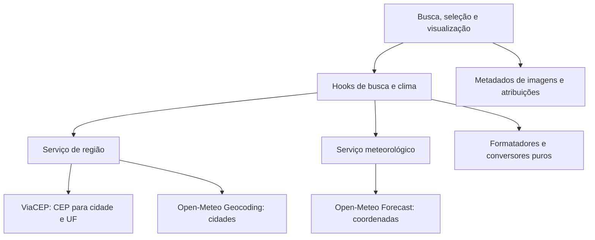
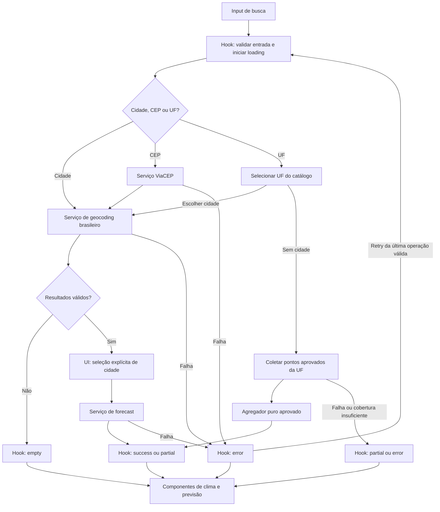

# Plano Técnico: Weather App

Este plano deriva da [especificação do produto](../specs/weather-app-spec.md) e orienta a decomposição em tarefas. Preserva a stack e as convenções já presentes no repositório, distinguindo decisões confirmadas de pontos que ainda precisam de decisão de produto.

## 1. Architecture (Overview)

Aplicação web client-side, sem backend próprio e sem autenticação. Componentes React cuidam da apresentação; hooks coordenam estado e fluxo de consulta; serviços isolam chamadas HTTP e normalização; tipos compartilhados definem contratos entre as camadas.



Responsabilidades principais:

- `components/`: busca, resultados selecionáveis, seletor de UF/cidade, clima atual, previsão, unidade e estados de carregamento/erro/vazio.
- `hooks/`: coordenação de estado da aba, seleção explícita de região, cancelamento e retry.
- `services/`: ViaCEP, geocoding, forecast e mapeamento de respostas externas para modelos de domínio.
- `data/`: lista fixa de UFs brasileiras, catálogo de imagens/licenças e, depois de aprovada a metodologia, pontos amostrais de UF.
- `lib/`: validação/formatação de CEP, conversão C/F, formatação de métricas e agregação pura.

Não adicionar backend ou store global nesta etapa: não há conta, persistência compartilhada ou sincronização entre abas requerida. Cada aba mantém estado React independente.

A dependência segue `components → hooks → services`, com `lib` e `types` compartilhados. Componentes recebem dados de domínio e callbacks, nunca respostas HTTP; hooks decidem quando consultar; serviços validam e normalizam o provedor; funções de `lib` não acessam rede nem estado React. Isso permite testar componentes com fixtures, hooks com serviços mockados e serviços com `fetch` mockado, sem depender de disponibilidade externa.

## 2. Tech Stack

| Área | Tecnologia/serviço | Uso e justificativa |
| --- | --- | --- |
| Linguagem e UI | TypeScript strict, React 19 | Já adotados no projeto; tipos para normalizar dados de APIs externas e componentes React para a experiência. |
| Build e desenvolvimento | Vite 8 | Já configurado; servidor local e build estático para publicação. |
| Estilos | Tailwind CSS 3 | Tema dark glassmorphism existente, mobile-first, fonte Inter, foco visível e grid de previsão em 2/3/5 colunas. |
| Ícones | Lucide React | Já instalado; ícones de controles não substituem as imagens Creative Commons das condições. |
| Testes unitários/componentes | Vitest, Testing Library, jsdom | Já instalados; cobrem lógica pura, serviços e interação acessível. |
| Testes de navegador | Playwright | Já configurado; valida fluxo integrado em computador e viewport de referência Moto G56. |
| Qualidade | Biome | Lint e formatação existentes. |
| Gerenciador | pnpm | Gerenciador definido pelo repositório. |
| Geocoding e previsão | Open-Meteo Geocoding API e Forecast API | Sem chave de API; geocoding de cidades e clima por latitude/longitude. |
| Resolução de CEP | ViaCEP | Converte CEP brasileiro em município e UF; endpoint público sem chave. |

Não é necessária nova dependência de runtime para o desenho proposto. Usar `fetch`, `AbortController` e `URLSearchParams`, como no serviço existente. Confirmar CORS, limites de uso e disponibilidade dos provedores antes da entrega.

## 3. Project Structure

Manter a estrutura atual e criar apenas módulos necessários à separação das novas responsabilidades:

```text
src/
  App.tsx
  components/
    SearchBar.tsx                 # ampliar ou substituir pelo formulário de busca
    RegionResults.tsx             # seleção explícita de resultados/homônimos
    StateSelector.tsx             # seletor pesquisável das 27 UFs
    CurrentWeather.tsx
    ForecastList.tsx
    ForecastCard.tsx
    UnitToggle.tsx
    WeatherAttribution.tsx        # créditos de imagens, quando exigidos
    states/                        # loading, erro, vazio e dados parciais
  hooks/
    useWeather.ts                 # estado e coordenação por aba
  services/
    cepService.ts                 # consulta ViaCEP
    geocodingService.ts           # busca Open-Meteo e filtragem Brasil/UF
    weatherService.ts             # consulta Open-Meteo Forecast
  data/
    mockWeather.ts                # fixtures da fase de UI; não usar como fallback de consulta real
    brazilStates.ts               # sigla e nome das UFs
    weatherAssets.ts              # código climático, arquivo e metadados de licença
    stateWeatherSamples.ts         # criar somente após decidir amostragem estadual
  lib/
    postalCode.ts                 # normalização/validação/formatação de CEP
    temperature.ts                # conversão Celsius/Fahrenheit
    weatherCodes.ts               # código meteorológico -> condição/asset
    aggregateWeather.ts           # agregador puro para amostras de UF
    format.ts                     # datas e unidades para pt-BR
  types/
    weather.ts                    # modelos de domínio e estados de API
  assets/
    weather/                      # imagens locais, após aprovação das licenças
  styles/
    index.css
```

O repositório já possui `CurrentWeather`, `ForecastList`, `ForecastCard`, `SearchBar`, `UnitToggle`, estados de UI, `useWeather`, `weatherService`, formatadores e tipos. As tarefas devem evoluir esses módulos ou renomeá-los apenas quando a responsabilidade realmente mudar; evitar duplicar componentes já existentes.

## 4. Data Model

Os serviços convertem respostas externas para modelos internos. Não propagar JSON cru das APIs para a UI. Coordenadas identificam a localização meteorológica; a UF selecionada é um escopo de busca/agregação, não uma coordenada.

```ts
type Unit = 'celsius' | 'fahrenheit'; // Preferência de apresentação; padrão Celsius.

interface City {
  id: number; // Identificador do resultado de geocoding.
  name: string; // Nome do município.
  stateCode: string; // Sigla da UF, validada no catálogo brasileiro.
  stateName: string; // Nome da UF, obtido de admin1 e normalizado pelo catálogo.
  countryCode: 'BR'; // País validado na resposta, não apenas no request.
  latitude: number; // Latitude em graus decimais.
  longitude: number; // Longitude em graus decimais.
}

type RegionSelection =
  | { kind: 'city'; city: City } // Cidade escolhida, inclusive dentro de uma UF.
  | { kind: 'state'; stateCode: string; stateName: string }; // UF sem cidade.

interface CurrentWeather {
  time: string; // Horário ISO local no fuso solicitado ao Forecast.
  temperatureC: number | null; // Temperatura a 2 m, sempre em Celsius.
  windSpeedKmh: number | null; // Vento a 10 m, em km/h.
  humidityPercent: number | null; // Umidade relativa a 2 m, em porcentagem.
  precipitationProbabilityPercent: number | null; // Chance de chuva da hora correspondente.
  weatherCode: number | null; // Código WMO da condição; null se indisponível.
}

interface ForecastDay {
  date: string; // Data YYYY-MM-DD no fuso do dispositivo.
  minTemperatureC: number | null; // Temperatura mínima diária em Celsius.
  maxTemperatureC: number | null; // Temperatura máxima diária em Celsius.
  windSpeedKmh: number | null; // Velocidade máxima diária em km/h.
  humidityPercent: number | null; // Umidade relativa média diária em porcentagem.
  precipitationProbabilityPercent: number | null; // Chance máxima diária de chuva.
  weatherCode: number | null; // Condição diária WMO.
}

interface WeatherData {
  region: RegionSelection; // Seleção explícita à qual os dados pertencem.
  current: CurrentWeather | null; // null quando o bloco atual estiver indisponível.
  forecast: ForecastDay[]; // Cinco datas consecutivas; série menor indica resposta parcial.
  timeZone: string; // Fuso IANA solicitado, igual ao configurado no dispositivo.
  isStateAggregate: boolean; // Diferencia agregado estadual de consulta pontual.
  sampleCount?: number; // Quantidade de amostras válidas, somente para agregado.
}
```

Estes são contratos propostos para evolução, não uma afirmação de que os tipos atuais já os implementam. Reutilizar os nomes `City`, `CurrentWeather`, `ForecastDay`, `WeatherData` e `Unit` existentes; migrar consumidores e fixtures na fase Code, sem criar modelos paralelos com nomes equivalentes. A união de seleção impede uma cidade sem coordenadas ou uma UF tratada como ponto meteorológico.

Contratos adicionais:

- `PostalCodeLookup`: CEP normalizado, município, UF, bairro/logradouro opcionais e indicador de não encontrado.
- `CityCandidate`: cidade e contexto de estado necessários para distinguir homônimos.
- `WeatherAsset`: código/condição, caminho local do asset, autor, URL de origem, identificador/URL da licença e texto de crédito.
- Temperaturas são mantidas em Celsius; conversão para Fahrenheit ocorre somente na apresentação.
- Vento é apresentado em km/h; umidade e chance de chuva em porcentagem. Métricas que a API não fornecer devem ser `null` e exibidas como indisponíveis, salvo a exceção diária a seguir.
- Exceção aprovada em 2026-11-11: um valor explicitamente `null` em `daily.precipitation_probability_max` é normalizado para `0` em `ForecastDay.precipitationProbabilityPercent`. Esta regra específica prevalece sobre as regras gerais de ausência no mapeamento e tratamento de erros deste plano. Campo/posição ausente, valor inválido e probabilidade horária atual continuam `null`; não aplicar o fallback às demais métricas.
- Na agregação estadual, `current` pode ser `null` se não houver cobertura suficiente; a UI deve representar indisponibilidade sem sugerir um valor medido.
- Os únicos campos meteorológicos do produto são temperatura, vento, umidade e chance de chuva. Precipitação em mm e pressão não substituem chance de chuva nem entram na UI final sem mudança da spec.
- `WeatherAsset` deve registrar licença Creative Commons específica e texto alternativo em pt-BR. Emoji ou ícone de biblioteca não atende, sozinho, ao requisito de imagem Creative Commons.

## 5. Data Flow

1. A pessoa informa nome de cidade, CEP ou seleciona uma UF. O estado da consulta é local à aba.
2. Cidade: normalizar o texto, pesquisar no geocoding com `countryCode=BR` e apresentar resultados com cidade e UF. Nenhum resultado é escolhido automaticamente; a pessoa seleciona a localidade.
3. CEP: considerar conclusão o blur ou envio do formulário; formatar apenas uma entrada completa e válida, sem alterar entrada parcial. Remover o hífen apenas para a chamada e consultar ViaCEP. Usar cidade/UF retornadas para geocoding no Brasil; filtrar pela UF e apresentar a localidade para confirmação explícita, mesmo quando houver apenas um resultado.
4. UF: carregar a lista local de UFs. Se a pessoa escolher cidade, seguir o fluxo de geocoding e seleção de cidade. Sem cidade, encaminhar à estratégia de agregação estadual descrita em `External APIs` e `Risks & Trade-offs`.
5. Após seleção explícita da cidade, chamar Forecast com coordenadas e o fuso horário do dispositivo, obtido por `Intl.DateTimeFormat().resolvedOptions().timeZone`.
6. Mapear as respostas para `WeatherData`: clima atual, cinco dias incluindo hoje, quatro métricas por dia e códigos de condição.
7. Para cada condição, obter imagem local pelo catálogo `weatherAssets`; exibir a atribuição correspondente à licença.
8. A UI apresenta temperaturas em Celsius inicialmente. A alternância C/F converte clima atual e todos os dias da previsão no cliente, sem repetir consulta.
9. Ao selecionar outra região, invalidar/cancelar a requisição anterior e substituir o resultado; uma resposta antiga não pode sobrescrever a seleção mais recente.



O caminho estadual depende da decisão de amostragem; o diagrama não autoriza inventar pontos ou fórmulas. Validação inválida permanece no formulário, sem consultar serviços. O hook também publica `loading` para a UI durante cada operação.

## 6. External APIs

### Open-Meteo Geocoding

- Endpoint: `https://geocoding-api.open-meteo.com/v1/search`
- Parâmetros principais: `name`, `count`, `language=pt`, `countryCode=BR`, `format=json`.
- Uso: procurar cidade; retornar identificador, nome, país, subdivisão administrativa e coordenadas. Conferir `country_code` também na resposta, não confiar somente no filtro enviado.
- Desambiguação: exibir município e UF; seleção explícita quando houver múltiplos resultados, incluindo homônimos.
- Limite: não resolve diretamente o requisito de agregação estadual; também não substitui o serviço de CEP.

Exemplo de request: `https://geocoding-api.open-meteo.com/v1/search?name=Sao%20Paulo&count=10&language=pt&countryCode=BR&format=json`.

Resposta ilustrativa resumida, não capturada ao vivo:

```json
{
  "results": [
    {
      "id": 3448439,
      "name": "São Paulo",
      "latitude": -23.5475,
      "longitude": -46.6361,
      "country_code": "BR",
      "country": "Brasil",
      "admin1": "São Paulo"
    }
  ]
}
```

Mapeamento: `id/name/latitude/longitude` alimentam os campos homônimos de `City`; `country_code` validado vira `countryCode`; `admin1` é associado ao catálogo das UFs para obter `stateCode/stateName`. Não interpretar `admin1_id` como sigla de UF. Resultados estrangeiros, sem coordenadas válidas ou sem UF resolvível não são selecionáveis; não inferir uma UF arbitrária. `results` ausente em uma resposta válida sem resultados ou `[]` produz lista vazia. Estrutura inesperada produz erro de provedor. Nunca selecionar automaticamente o primeiro resultado.

### ViaCEP

- Endpoint: `https://viacep.com.br/ws/{cep}/json/`
- Método: `GET`, CEP com oito dígitos sem hífen na URL. O hífen é apenas formatação da interface.
- Uso: obter município e UF brasileiros e então geocodificar a cidade para obter coordenadas.
- Erros: resposta `erro`, resposta inválida, timeout, falha de rede ou município sem correspondência no geocoding devem gerar estados distintos e mensagens claras.
- Privacidade: o CEP é enviado a um serviço externo. Não persistir CEP ou histórico; informar a dependência no aviso de privacidade/documentação do produto.

### Open-Meteo Forecast

- Endpoint: `https://api.open-meteo.com/v1/forecast`
- Parâmetros de localização: `latitude`, `longitude`.
- Variáveis atuais: `temperature_2m`, `relative_humidity_2m`, `wind_speed_10m`, `weather_code` e, para chance de chuva atual, `hourly=precipitation_probability` associado ao horário atual.
- Variáveis diárias: `temperature_2m_min`, `temperature_2m_max`, `wind_speed_10m_max`, `relative_humidity_2m_mean`, `precipitation_probability_max`, `weather_code`.
- Parâmetros temporais/unidades: `forecast_days=5`, `timezone=<fuso do dispositivo>`, `wind_speed_unit=kmh`, temperaturas retornadas em Celsius.
- Alinhamento: usar o fuso do dispositivo conforme requisito; identificar as datas devolvidas pela API sem recalcular a janela no fuso local da região.
- Validar que as séries diárias têm cinco entradas e que as variáveis opcionais existem; ausências permanecem `null`.

Parâmetros definidos para a consulta pontual:

| Parâmetro | Valor |
| --- | --- |
| `latitude`, `longitude` | Coordenadas da cidade selecionada |
| `current` | `temperature_2m,relative_humidity_2m,wind_speed_10m,weather_code` |
| `hourly` | `precipitation_probability` |
| `daily` | `temperature_2m_min,temperature_2m_max,wind_speed_10m_max,relative_humidity_2m_mean,precipitation_probability_max,weather_code` |
| `timezone` | Fuso IANA do dispositivo, por exemplo `America/Sao_Paulo`; não usar `auto` |
| `forecast_days` | `5` |
| `temperature_unit` | `celsius`, independentemente da unidade escolhida na UI |
| `wind_speed_unit` | `kmh` |

Resposta ilustrativa resumida; blocos `*_units` e demais horas foram omitidos:

```json
{
  "timezone": "America/Sao_Paulo",
  "current": {
    "time": "2026-11-11T14:15",
    "temperature_2m": 24,
    "relative_humidity_2m": 68,
    "wind_speed_10m": 14,
    "weather_code": 2
  },
  "hourly": {
    "time": ["2026-11-11T14:00", "2026-11-11T15:00"],
    "precipitation_probability": [20, 25]
  },
  "daily": {
    "time": ["2026-11-11", "2026-11-12", "2026-11-13", "2026-11-14", "2026-11-15"],
    "temperature_2m_min": [18, 19, 18, 17, 18],
    "temperature_2m_max": [26, 28, 23, 22, 25],
    "wind_speed_10m_max": [14, 12, 22, 18, 13],
    "relative_humidity_2m_mean": [68, 62, 85, 78, 70],
    "precipitation_probability_max": [20, 5, 80, 40, 10],
    "weather_code": [2, 0, 61, 3, 1]
  }
}
```

Mapeamento para os contratos:

| Origem | Destino |
| --- | --- |
| Seleção confirmada no hook | `WeatherData.region` |
| `timezone` validado contra o solicitado | `WeatherData.timeZone` |
| `current.time` | `CurrentWeather.time` |
| `current.temperature_2m` | `CurrentWeather.temperatureC` |
| `current.relative_humidity_2m` | `CurrentWeather.humidityPercent` |
| `current.wind_speed_10m` | `CurrentWeather.windSpeedKmh` |
| `current.weather_code` | `CurrentWeather.weatherCode` |
| Probabilidade da hora correspondente em `hourly` | `CurrentWeather.precipitationProbabilityPercent` |
| `daily.time[index]` | `ForecastDay.date` |
| `daily.temperature_2m_min/max[index]` | `ForecastDay.minTemperatureC/maxTemperatureC` |
| `daily.wind_speed_10m_max[index]` | `ForecastDay.windSpeedKmh` |
| `daily.relative_humidity_2m_mean[index]` | `ForecastDay.humidityPercent` |
| `daily.precipitation_probability_max[index]` | `ForecastDay.precipitationProbabilityPercent` |
| `daily.weather_code[index]` | `ForecastDay.weatherCode` |

No exemplo, o horário atual 14:15 corresponde ao intervalo iniciado às 14:00, portanto a chance atual é 20%, não 25%. Comparar data e hora completas no mesmo fuso; se a hora correspondente não existir, manter `null`, sem buscar o primeiro valor nem usar o máximo diário como substituto. Datas diárias devem ser tratadas como datas civis, sem conversão implícita de UTC.

Validar números finitos, percentuais entre 0 e 100 e alinhamento das séries pelo índice de `daily.time`. Campo ausente/inválido vira `null`; nunca deslocar uma série para preencher outra. Série menor, data inicial divergente do dia no dispositivo ou datas não consecutivas geram `partial` com aviso explícito; estrutura totalmente inutilizável gera erro. Não fabricar dias ou métricas para aparentar sucesso. `isStateAggregate` é `false` na consulta pontual; somente o agregador pode produzir `true` e `sampleCount`.

### Agregação estadual: integração pendente de decisão

Forecast é uma API baseada em pontos de latitude/longitude, não um serviço de agregação por polígono estadual. Proposta técnica: manter pontos representativos por UF em `stateWeatherSamples.ts`, consultar esses pontos e agregar resultados com função pura. A lista e a quantidade de pontos não devem ser inventadas na implementação: dependem da resposta à pergunta de cobertura/método na spec.

Proposta inicial de cálculo, sujeita à aprovação de produto: média para temperatura, umidade e chance de chuva; máximo para velocidade do vento; condição mais frequente para o código climático. Exigir cobertura mínima acordada e marcar o relatório como agregado. Se a cobertura mínima não for atendida, retornar dados parciais/indisponíveis em vez de apresentar uma amostra como se representasse o estado inteiro.

## 7. State Management

- Manter estado de produto em `useWeather` ou em hooks próximos, usando `useState`; não adicionar Redux, Zustand ou outro store global para esta aplicação sem requisito novo.
- Estado sugerido: `query`, `searchMode`, candidatos, `selectedRegion`, unidade, resultado, erro tipado e estado da operação (`idle`, `loading`, `success`, `empty`, `error`, `partial`).
- Cada aba recebe uma instância própria da aplicação React e mantém estado em memória. Não gravar seleção em `localStorage`, não sincronizar via `BroadcastChannel` e não compartilhar estado entre abas.
- Separar pesquisa de seleção: resultados permanecem visíveis até escolha explícita; seleção da UF pode abrir uma escolha opcional de cidade antes da agregação.
- A unidade pode ser estado local em `App`; alternar unidade não invalida o resultado nem executa request.
- Usar `AbortController` por operação ou identificador monotônico de requisição para descartar respostas obsoletas ao pesquisar novamente, trocar região ou desmontar a tela.
- Persistência após atualizar a página não está requerida; manter a escolha em memória evita compartilhamento acidental entre abas.

Separar estado da busca e estado do clima, usando o mesmo vocabulário de operação, sem criar uma máquina de estados externa:

| Estado | Busca | Consulta meteorológica |
| --- | --- | --- |
| `idle` | Nenhuma busca enviada | Nenhuma seleção confirmada |
| `loading` | Resolução de cidade/CEP em curso | Forecast ou coleta estadual em curso |
| `success` | Candidatos disponíveis, aguardando seleção | Todos os campos e cinco dias válidos |
| `empty` | Nenhum candidato brasileiro válido | Resposta válida sem dados meteorológicos |
| `error` | Rede, timeout ou resposta inválida | Falha sem relatório utilizável |
| `partial` | Não utilizado para candidatos | Há relatório utilizável, mas faltam campos/dias ou cobertura aprovada |

Transições: envio válido leva a `loading`; resposta leva a `success`, `empty` ou `error`. Seleção explícita inicia o loading meteorológico, que termina em `success`, `partial`, `empty` ou `error`. Antes da seleção não há request meteorológico. Não sincronizar estados em efeitos dependentes da unidade.

A apresentação deriva Fahrenheit pela fórmula `temperatureC * 9 / 5 + 32`, arredondando somente o texto exibido; mínimos e máximos seguem a mesma regra. `null` continua indisponível nas duas unidades. Não guardar uma cópia dos dados convertidos nem alterar os valores originais. A unidade deve aparecer junto das temperaturas.

## 8. Error Handling

Representar falhas como erros tipados da camada de serviço e convertê-los em mensagens de interface na fronteira do hook. Categorias recomendadas:

- `invalid-input`: CEP fora do formato válido ou busca vazia.
- `not-found`: CEP sem resultado ou cidade sem correspondência brasileira.
- `ambiguous`: múltiplas regiões exigem seleção; isso é estado de seleção, não erro de rede.
- `network` / `timeout`: indisponibilidade, conexão ou timeout; permitir retry.
- `provider-error`: resposta HTTP inválida ou erro do provedor; permitir retry quando transitório.
- `incomplete-data`: resposta sem séries/campos necessários; mostrar métricas indisponíveis e não fabricá-las.
- `aggregate-unavailable` / `partial`: cobertura estadual insuficiente; explicar que não foi possível compor a agregação.

Política de interação:

- Mostrar loading durante consulta e vazio após resposta válida sem resultados.
- Ao confirmar nova seleção, ocultar o relatório anterior e mostrar loading no novo contexto. Uma busca ainda não confirmada não renomeia o relatório existente. Guardar a última operação válida apenas para retry, sem exibir seu resultado sob a nova região.
- Retry apenas para falhas transitórias, usando a última busca/seleção válida da aba.
- Aplicar timeout às chamadas externas via `AbortController`; limpar timers e abortar operações substituídas.
- Ao mudar de região rapidamente, somente a resposta da seleção atual pode atualizar a UI.
- Usar `null` para valores ausentes e fornecer apresentação acessível de “indisponível”. Não converter probabilidade ausente em 0%.
- Nunca registrar CEP completo ou dados pessoais em logs. A aplicação não solicita localização automaticamente.

Timeout técnico proposto: 10 segundos por chamada, configurável no serviço e validado com timers falsos. Esse limite evita loading infinito, mas não constitui meta de desempenho aprovada. Cancelamento por troca de seleção ou desmontagem não deve aparecer como erro; timeout deve. Verificar `response.ok` antes do JSON e validar o payload antes de mapear. Erros HTTP 429/5xx permitem retentativa manual; não adicionar retries automáticos que multipliquem chamadas estaduais. Resposta parcial mantém os dados válidos com aviso, valores ausentes identificados e opção de tentar novamente; se nenhum dado for utilizável, não renderizar um painel de sucesso.

## 9. Testing Strategy

### Unitários — Vitest

- `postalCode`: normalização, validação de oito dígitos, formatação após conclusão da entrada e tratamento de CEP inválido.
- `temperature`: conversões C/F, arredondamento de apresentação e ausência de novas chamadas ao alternar unidade.
- `aggregateWeather`: médias/máximo/moda, cobertura mínima, arrays de datas incompatíveis e campos ausentes; implementar após aprovar a regra de agregação.
- Mapeadores: Open-Meteo/ViaCEP para tipos internos, respostas incompletas e ausência de campos opcionais.
- `weatherCodes` e catálogo de assets: condição associada ao recurso e metadados/atribuição presentes.

### Componentes — Testing Library

- Busca por cidade, CEP e UF; formato de CEP após conclusão; opções de UF pesquisáveis por sigla/nome.
- Resultados brasileiros e homônimos exigem seleção explícita antes de carregar clima.
- Seleção de cidade dentro de UF e fluxo de agregação sem cidade selecionada.
- Exibir quatro métricas no clima atual e nos cinco dias; unidade, estado loading/erro/vazio/parcial e atribuição da imagem.
- Teclado, nomes acessíveis e resposta a erro/ausência de resultados.
- Fixtures independentes de rede cobrem explicitamente loading, erro com retry, vazio e sucesso; a UI mock não é evidência de integração externa funcionando.
- Estado isolado entre duas instâncias renderizadas da aplicação; selecionar região em uma não altera a outra.

### Integração de serviços

- Mockar `fetch`; verificar parâmetros, filtro/validação de país e mapeamento das APIs ViaCEP e Open-Meteo.
- Cobrir HTTP não-OK, JSON inválido, timeout, aborto, ausência de resultados e campos meteorológicos ausentes.
- Verificar `forecast_days=5`, fuso horário do dispositivo, unidades, correspondência do horário atual à probabilidade horária e cinco dias retornados.
- Confirmar que respostas de uma requisição cancelada/antiga não substituem dados da busca atual.

### E2E — Playwright

- Fluxo feliz por cidade com seleção explícita, clima atual e previsão de cinco dias.
- Busca por homônimo, CEP inválido/válido, seleção de UF com e sem cidade e estados de falha/retentativa.
- Alternância C/F mantém os mesmos dados e muda apenas a apresentação da temperatura.
- Validar viewport de referência Moto G56 e uma viewport desktop; buscar ausência de overflow horizontal e controles utilizáveis.
- Abrir duas abas independentes e confirmar que a região selecionada em uma não altera a outra.
- Preferir respostas de rede mockadas para cenários determinísticos; manter ao menos uma verificação de integração externa separada, se aprovada para CI.
- Registrar largura/altura em pixels CSS, escala e navegador adotados como referência Moto G56; validar também em aparelho real quando disponível. Emulação de viewport não comprova compatibilidade física com o dispositivo. Capturar screenshots e conferir grid 2/3/5, ausência de cortes, foco e controles operáveis.

Comandos de qualidade existentes: `pnpm lint`, `pnpm build`, `pnpm test` e `pnpm test:e2e`.

Esses gates pertencem às fases Code/Test; uma alteração somente neste plano exige revisão documental, não execução de build/lint/test. Na execução E2E, provisionar os navegadores e dependências do Playwright; registrar bloqueios ambientais sem declarar responsividade validada.

## 10. Risks & Trade-offs

| Risco/decisão | Consequência | Mitigação ou trade-off |
| --- | --- | --- |
| ViaCEP adiciona um provedor externo para CEP. | Busca depende de disponibilidade/CORS e envia o CEP ao provedor. | Isolar em `cepService`, não persistir a entrada, tratar falhas e documentar o envio. |
| Open-Meteo fornece previsão por coordenadas, não agregação de UF. | Uma agregação requer pontos amostrais e regras estatísticas próprias; pode não representar todas as áreas do estado. | Não simular agregado com a capital. Obter decisão de cobertura e método; indicar sempre que valores são agregados. |
| Consultar vários pontos por UF aumenta tráfego/latência e risco de limite do provedor. | Uma busca de UF pode ser mais lenta ou parcialmente indisponível. | Definir quantidade limitada de pontos, suportar resposta parcial segundo cobertura mínima aprovada e avaliar cache apenas após requisito de atualização/privacidade. |
| O fuso do dispositivo define o período, embora a localização consultada possa estar em outro fuso. | “Hoje” no app pode não ser o dia local da cidade. | Seguir o requisito da spec, incluir fuso no request e exibir datas; validar esta escolha com produto se houver reclamação de inconsistência. |
| Probabilidade de precipitação atual pode não existir no objeto `current` do provedor. | A métrica requer associar série horária ao horário atual e pode vir ausente. | Mapear a hora correspondente; preservar `null` se não houver valor, sem inferir 0%. |
| Licenças abertas têm condições diferentes. | Crédito ou restrições podem ser esquecidos em assets locais. | Manter metadados de licença por imagem e revisar atribuições antes da publicação. |
| Sem persistência entre carregamentos. | Atualizar a página limpa a seleção. | Aceitável pela spec e favorece isolamento por aba; persistência exige nova decisão de produto. |

**Decisões que bloqueiam implementação completa:** definir pontos/critério de agregação estadual e cobertura mínima; fallback para agregação ausente; fonte de imagens e formato de créditos; meta de desempenho. Até essas respostas, os contratos devem aceitar dados parciais sem apresentar valores inventados.

### Alternativas consideradas

| Escolha | Alternativa | Motivo da decisão |
| --- | --- | --- |
| React local + hooks | Redux/Zustand ou máquina de estados externa | Fluxo por aba pequeno; evitar dependências e sincronização desnecessárias. |
| Serviços com `fetch` | SDK HTTP ou biblioteca de cache | Poucos endpoints; APIs nativas bastam. Reavaliar somente com necessidade comprovada de cache/revalidação. |
| Aplicação client-side | Backend intermediário | APIs públicas sem chave; backend adicionaria operação e implantação. Reavaliar se CORS, políticas de uso ou limites exigirem proxy. |
| Catálogo local das 27 UFs | Descobrir UFs pelo geocoding | Lista finita e determinística, busca por nome/sigla testável sem rede. |
| Agregação com método aprovado | Usar a capital como representação estadual | Capital não é agregado; alternativa rejeitada por contrariar a spec. |
| Imagens locais com metadados | Hotlinks ou emojis como única ilustração | Controle de licença, disponibilidade e atribuição; catálogo ainda depende de aprovação. |
| Conversão na renderização | Pedir Fahrenheit ao Forecast ou armazenar duas cópias | Evita novo request, divergência e arredondamento acumulado. |

### Revisão de cobertura — P4.8

| Requisito | Decisão e verificação previstas |
| --- | --- |
| FR-01 | Geocoding filtrado e validado como BR; testes de serviço e busca. |
| FR-02 | Catálogo de 27 UFs, seletor pesquisável por sigla/nome e cidade opcional; testes de unicidade e interação. |
| FR-03 | ViaCEP, validação de oito dígitos e formatação em blur/submit; testes de entrada parcial, inválida e não encontrada. |
| FR-04 | Seleção explícita, contexto de UF e descarte de respostas antigas; E2E com homônimos. |
| FR-05 | Quatro métricas atuais e diferenciação cidade/UF; entrega estadual depende de regra e cobertura aprovadas. |
| FR-06 | Imagens Creative Commons com texto alternativo e créditos; entrega depende de catálogo/licenças aprovados. |
| FR-07 | Hoje + quatro dias no fuso do dispositivo e quatro métricas diárias; testes de datas, séries e valores ausentes. |
| FR-08 | Celsius inicial, conversão derivada para todos os valores e nenhuma consulta extra; testes de componentes/E2E. |
| FR-09 | Nova seleção substitui dados no contexto correto; testes de cancelamento e concorrência. |
| NFR-01 | Tailwind mobile-first; viewport documentado de referência Moto G56 e desktop, sem overflow. |
| NFR-02 | Sem conta, autenticação ou backend próprio. |
| NFR-03 | Licença e atribuição por asset; validação de metadados e revisão antes da publicação. |
| NFR-04 | Sem geolocalização automática; eventual recurso exige consentimento e tratamento de recusa. |
| NFR-05 | Estado React em memória por aba, sem storage compartilhado; E2E com duas abas. |
| NFR-06 | Labels, seleção por teclado, foco visível e texto alternativo; testes de interação e inspeção visual. |
| NFR-07 | Estados explícitos, timeout, retry e parcial sem valores inventados; testes determinísticos de falha. |
| NFR-08 | Interface, mensagens, datas e unidades contextualizadas em pt-BR. |

**Resultado da revisão:** todos os requisitos possuem encaminhamento no plano, mas isso não significa implementação ou validação concluída. Foram corrigidos contratos não anuláveis para métricas ausentes, nomes divergentes dos solicitados e ambiguidade sobre dados antigos após troca de seleção. A UI estática existente deve ser alinhada à spec na fase Code: não carregar cidade automaticamente no fluxo real, não substituir chance de chuva por precipitação em mm/pressão e não tratar emoji como imagem Creative Commons.

Não há justificativa atual para backend, store global, persistência, SDK HTTP ou uma arquitetura adicional de resolução de região. Serviços pequenos coordenados pelo hook são suficientes e seguem `.github/copilot-instructions.md`. As decisões de agregação, fallback estadual e catálogo de imagens continuam pendentes de produto; a meta de desempenho pendente bloqueia sua aceitação quantitativa, não o planejamento da UI. Não presumir aprovação dessas decisões nem alterar a spec para acomodar limitações da implementação.